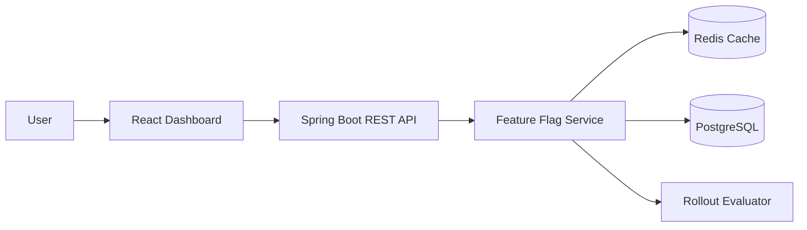

# Feature Flag & Evaluation Platform

A full-stack feature flag platform built with **Java, Spring Boot, React, PostgreSQL, and Redis**. It provides APIs and a dashboard to manage feature flags, control percentage-based rollouts, and evaluate whether a feature should be enabled for a given user.

## Architecture

See [`docs/architecture.md`](docs/architecture.md) for the architecture diagrams, evaluation flow, cache invalidation flow, and design decisions.

**High-level request flow:**



## Features

- **Feature flag management:** Create, view, update, enable, disable, and delete flags.
- **Percentage-based rollouts:** Deterministic user bucketing using SHA-256 hashing.
- **Evaluation API:** Evaluate a flag for a supplied user ID.
- **Evaluation playground:** Test flag evaluation from the React dashboard.
- **Redis caching:** Cache flag data with a TTL to reduce database reads.
- **Cache invalidation:** Invalidate affected cache entries after successful database updates and deletes.
- **Optimistic locking:** Use entity versioning to detect conflicting concurrent updates.
- **Input validation and error handling:** Validate API requests and return consistent HTTP error responses.
- **Observability:** Spring Boot Actuator health and metrics endpoints.
- **API documentation:** OpenAPI/Swagger UI.

## Tech Stack

| Layer | Technology |
|---|---|
| Backend | Java 21, Spring Boot |
| API | REST, Spring Data JPA |
| Frontend | React, JavaScript, Vite, Axios |
| Database | PostgreSQL |
| Cache | Redis |
| Database migrations | Flyway |
| Testing | JUnit, Spring Boot Test |
| Load testing | k6 |
| Containerization | Docker Compose |
| CI | GitHub Actions |

## Running Locally

### Prerequisites

- Java 21
- Node.js and npm
- Docker Desktop
- Git

### 1. Clone the repository

```bash
git clone <YOUR_GITHUB_REPOSITORY_URL>
cd feature-flag-platform
```

### 2. Configure environment variables

Create your local environment file:

```bash
cp .env.example .env
```

Update the values if needed. Do not commit `.env` or put real credentials in source control.

### 3. Start PostgreSQL and Redis

```bash
docker compose up -d
```

### 4. Start the backend

```bash
cd backend
./gradlew bootRun
```

The backend runs at `http://localhost:8080`.

### 5. Start the frontend

In a separate terminal:

```bash
cd frontend
npm install
npm run dev
```

The frontend runs at `http://localhost:5173`.

## API Overview

Base URL: `/api/v1`

| Method | Endpoint | Description |
|---|---|---|
| GET | `/flags` | List feature flags |
| GET | `/flags/{id}` | Get a flag by ID |
| POST | `/flags` | Create a feature flag |
| PUT | `/flags/{id}` | Update a feature flag |
| DELETE | `/flags/{id}` | Delete a feature flag |
| POST | `/flags/evaluate` | Evaluate a flag for a user |

### Example evaluation request

```http
POST /api/v1/flags/evaluate
Content-Type: application/json
```

```json
{
  "flagKey": "new_checkout",
  "userId": "user-123"
}
```

The response indicates whether the flag is enabled for that user and includes an evaluation reason.

## Testing

### Backend

```bash
cd backend
./gradlew clean test
```

### Frontend

```bash
cd frontend
npm ci
npm run lint
npm run build
```

### Load testing

The local k6 test run recorded:

- 10 virtual users
- 30-second test duration
- 138,480 requests
- Approximately 4,615 requests/second
- p95 latency: approximately 3.44 ms
- 0% failed checks

**Note:** These are results from a local development environment, not a production capacity claim. Results vary with hardware, infrastructure, data, and test conditions.

## Engineering Decisions

- **PostgreSQL as the source of truth:** Persistent feature flag state is stored in a relational database.
- **Redis for read caching:** Frequently accessed flag data is cached with a time-to-live.
- **After-commit invalidation:** Cache invalidation is triggered after the database transaction commits, avoiding invalidation for rolled-back changes.
- **Optimistic locking:** Version-based updates help detect concurrent modifications.
- **Deterministic rollout assignment:** A stable hash of the flag key and user ID produces repeatable percentage-based assignment.

## Current Scope and Limitations

This project focuses on feature flag CRUD, percentage-based evaluation, caching, and concurrency handling.

- Authentication and role-based authorization are not implemented yet.
- Rollout targeting is percentage-based; advanced user attributes and rule targeting are not included.
- The current implementation does not provide multi-environment management or a complete experimentation/analytics workflow.
- The Experiments and Environments navigation entries are placeholders.

This is a portfolio and learning project, not a production-ready feature management service. Do not use it to manage sensitive production flags without adding authentication, authorization, security hardening, and operational safeguards.

## Future Improvements

- Authentication and role-based access control
- Environment-specific flags
- Advanced targeting rules
- Audit history and change tracking
- Automated integration and end-to-end tests
- Improved deployment monitoring
