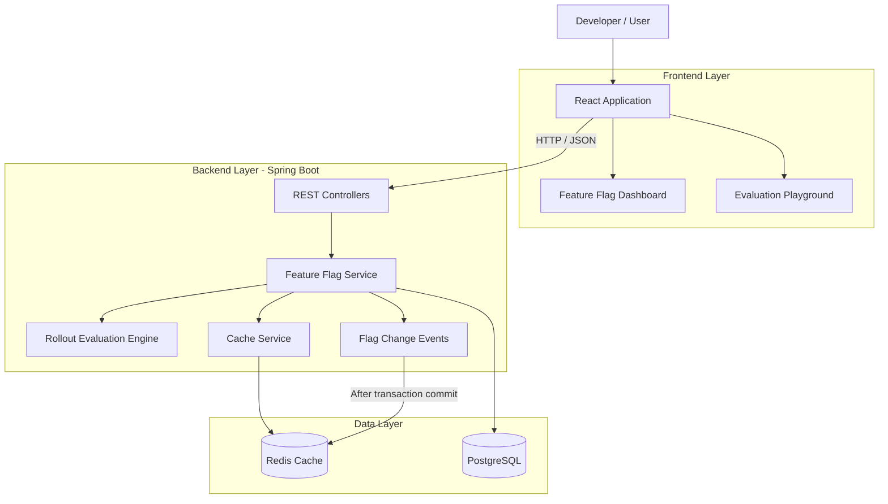
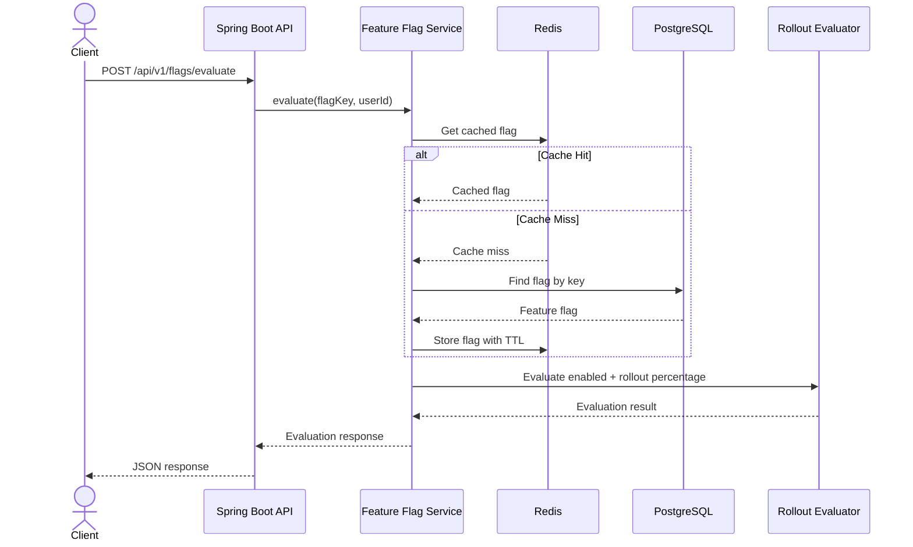
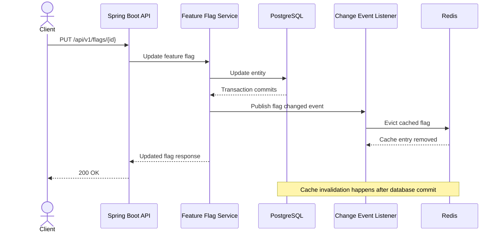

# Feature Flag Platform — Architecture

## 1. High-Level System Architecture

## 2. Feature Flag Evaluation Flow

## 3. Cache Invalidation Flow

## 4. Key Architectural Decisions

### PostgreSQL — Persistent Storage

PostgreSQL stores feature flag definitions and acts as the source of truth.

### Redis — Caching Layer

Redis reduces repeated database reads during feature flag evaluation. Cached entries use a time-to-live (TTL).

### Cache Invalidation After Transaction Commit

A flag update or deletion publishes a change event. The event listener invalidates the corresponding Redis entry after the database transaction commits.

This prevents invalidating the cache before the database change is successfully committed.

### Optimistic Locking

The feature flag entity uses a version field to detect conflicting concurrent updates. A stale update is rejected rather than silently overwriting a newer change.

### Deterministic Percentage Rollout

The evaluation engine uses stable hash-based assignment so the same user receives a consistent rollout decision for a given flag.

### Graceful Cache Fallback

If Redis is unavailable, the application can fall back to the database rather than making the cache a hard dependency for evaluation.

## 5. API Overview

| Method | Endpoint | Purpose |
|---|---|---|
| GET | `/api/v1/flags` | List flags |
| POST | `/api/v1/flags` | Create a flag |
| GET | `/api/v1/flags/{id}` | Get a flag |
| PUT | `/api/v1/flags/{id}` | Update a flag |
| DELETE | `/api/v1/flags/{id}` | Delete a flag |
| POST | `/api/v1/flags/evaluate` | Evaluate a flag for a user |

## 6. Current Scope and Limitations

- Authentication and authorization are not implemented.
- The application currently supports a single environment configuration.
- The cache is Redis-backed, with database fallback.
- The platform supports percentage-based rollout rather than a full experimentation or targeting rules engine.
- Load-test results represent a local development benchmark, not production capacity.